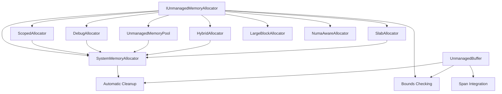

# ZiggyAlloc

ZiggyAlloc is an unmanaged memory library for .NET.
It provides explicit allocation strategies for code where GC behavior is unacceptable or unpredictable.

ZiggyAlloc prioritizes explicit lifetimes and predictable behavior over convenience.

[](https://www.nuget.org/packages/ZiggyAlloc/)
[](https://github.com/alexzzzs/ziggyalloc/actions)
[](LICENSE)

---

## Non-Goals

ZiggyAlloc does not:

* Replace the .NET GC
* Provide general-purpose allocation
* Offer transparent thread safety
* Perform automatic lifetime inference
* Make unsafe code safe

---

## Key Features

* Explicit allocator types with defined lifetimes
* Direct unmanaged memory access
* Type-safe buffers with bounds checking
* Deterministic cleanup via `IDisposable`
* Zero-copy conversion to `Span<T>`
* Optional pooling and reuse
* Optional debug tracking and leak detection
* Optional alignment and NUMA-aware allocation

---

## How to Think About ZiggyAlloc

* Allocators own memory; buffers are views
* Disposal is a lifetime boundary
* Thread safety is allocator-specific
* Allocation strategy is a design decision, not an optimization toggle

---

## Specialized Allocators

### NumaAwareAllocator

NUMA-aware memory allocation for multi-socket systems.

```csharp
using var numaAllocator = Z.CreateNumaAwareAllocator();
using var buffer = numaAllocator.Allocate<int>(1000);

// Memory allocated on same NUMA node as requesting thread
var stats = numaAllocator.GetNodeStatistics();
```

Supports Windows, Linux, and macOS.

### AlignedAllocator

Memory alignment for SIMD operations.

```csharp
using var alignedAllocator = Z.CreateAlignedAllocator();
using var buffer = alignedAllocator.Allocate<Vector128<float>>(1000);

var stats = alignedAllocator.GetAlignmentStatistics();
Console.WriteLine($"Alignment efficiency: {stats.AlignmentEfficiency:F1}%");
```

Supports SSE, AVX, AVX-512, ARM NEON with multiple alignment strategies.

---

## Quick Start

```csharp
using ZiggyAlloc;

// Create allocator
var allocator = new SystemMemoryAllocator();

// Allocate memory with automatic cleanup
using var buffer = allocator.Allocate<int>(1000);

// Use like a normal array with bounds checking
buffer[0] = 42;
int value = buffer[0];

// Convert to Span<T> for high-performance operations
Span<int> span = buffer;
span.Fill(123);
```

---

## Performance Notes

ZiggyAlloc avoids GC pressure and can reduce allocation overhead in specific workloads.
Detailed benchmarks are available in `docs/performance.md`.

Performance varies by hardware and access pattern.

---

## Allocator Selection

| Allocator             | Use When                     | Thread Safe | Notes                          |
| --------------------- | ---------------------------- | ----------- | ------------------------------ |
| SystemMemoryAllocator | General unmanaged use        | Yes         | Wraps OS allocation            |
| ScopedAllocator       | Temporary phases             | No          | Frees on dispose               |
| SlabAllocator         | Many small fixed allocations | Yes         | Size-class based               |
| UnmanagedMemoryPool   | Frequent reuse               | Yes         | Reduces OS calls               |
| DebugAllocator        | Development                  | Yes         | Tracks leaks                   |
| HybridAllocator       | Mixed workloads              | Yes         | Chooses strategy automatically |
| LargeBlockAllocator   | Large allocations (>64KB)    | Yes         | Memory pooling                 |
| NumaAwareAllocator    | Multi-socket systems         | Yes         | Hardware dependent             |
| AlignedAllocator      | SIMD-heavy workloads         | Yes         | Hardware dependent             |

> Thread safety may involve internal locking and has a performance cost.

---

## Architecture Overview



---

## Core Concepts

### UnmanagedBuffer<T>

The core type for working with unmanaged memory:

```csharp
var allocator = new SystemMemoryAllocator();
using var buffer = allocator.Allocate<int>(100);

// Type-safe access with bounds checking
buffer[0] = 42;
int value = buffer[99];

// Convert to Span<T> for high-performance operations
Span<int> span = buffer;
span.Fill(123);
```

---

### Multiple Allocator Strategies

#### SystemMemoryAllocator

Direct system memory allocation with tracking.

#### ScopedAllocator

Arena-style allocator that frees all memory when disposed.

#### DebugAllocator

Tracks allocations and detects memory leaks with caller information.

#### UnmanagedMemoryPool

Reduces allocation overhead by reusing previously allocated buffers.

#### HybridAllocator

Automatically chooses between managed and unmanaged allocation based on size and type for optimal performance.

#### SlabAllocator

A slab allocator that pre-allocates large blocks of memory and sub-allocates from them.

```csharp
var systemAllocator = new SystemMemoryAllocator();
using var slabAllocator = new SlabAllocator(systemAllocator);

// Small allocations are served from pre-allocated slabs
using var smallBuffer = slabAllocator.Allocate<int>(100);

// Large allocations are delegated to the base allocator
using var largeBuffer = slabAllocator.Allocate<int>(10000);
```

Characteristics:

* Fast allocation for small objects
* No internal fragmentation
* Good cache locality

Use cases:

* High-frequency small allocations of similar sizes
* Performance-critical code paths
* Scenarios where allocation patterns are predictable

#### LargeBlockAllocator

Optimized for large memory blocks (>64KB) with pooling and alignment.

```csharp
var systemAllocator = new SystemMemoryAllocator();
using var largeBlockAllocator = new LargeBlockAllocator(systemAllocator);

// Large allocations automatically benefit from pooling and alignment
using var largeBuffer = largeBlockAllocator.Allocate<byte>(1024 * 1024); // 1MB

// Memory is automatically pooled for reuse
using var anotherBuffer = largeBlockAllocator.Allocate<byte>(1024 * 1024); // Reuses pooled memory
```

Characteristics:

* Memory pooling for large blocks
* 4KB alignment for performance
* SIMD integration
* Size-class optimization

Use cases:

* Large data processing (images, scientific data, etc.)
* High-performance computing scenarios
* Applications with predictable large allocation patterns

---

## Examples

The [examples](examples/) directory contains organized examples:

### Basic Usage

* Simple memory allocation and automatic cleanup
* Using `using` statements for RAII-style memory management

### Advanced Features

* Different allocator types and their use cases
* Memory leak detection
* High-performance buffer operations
* Native interop scenarios

### Performance Optimization

* Memory pooling for frequent allocations
* Hybrid allocation strategies
* Avoiding GC pressure with large allocations

### Real-World Applications

* Image processing without GC pressure
* Scientific computing with large datasets
* Native API interop

To run examples:

```bash
cd examples
dotnet run -- basic
dotnet run -- allocators
dotnet run -- realworld
```

---

## Installation

```bash
dotnet add package ZiggyAlloc
```

Or in your `.csproj`:

```xml
<PackageReference Include="ZiggyAlloc" Version="1.3.0" />
```

---

## Documentation

* [Getting Started Guide](GETTING_STARTED.md)
* [Full API Documentation](DOCUMENTATION.md)
* [Examples](examples/README.md)
* [Performance Benchmarks](docs/performance.md)

---

## Requirements

* .NET 8.0 or later
* `unsafe` code enabled (configured in package)

---

## License

This project is licensed under the MIT License – see the [LICENSE](LICENSE) file for details.

